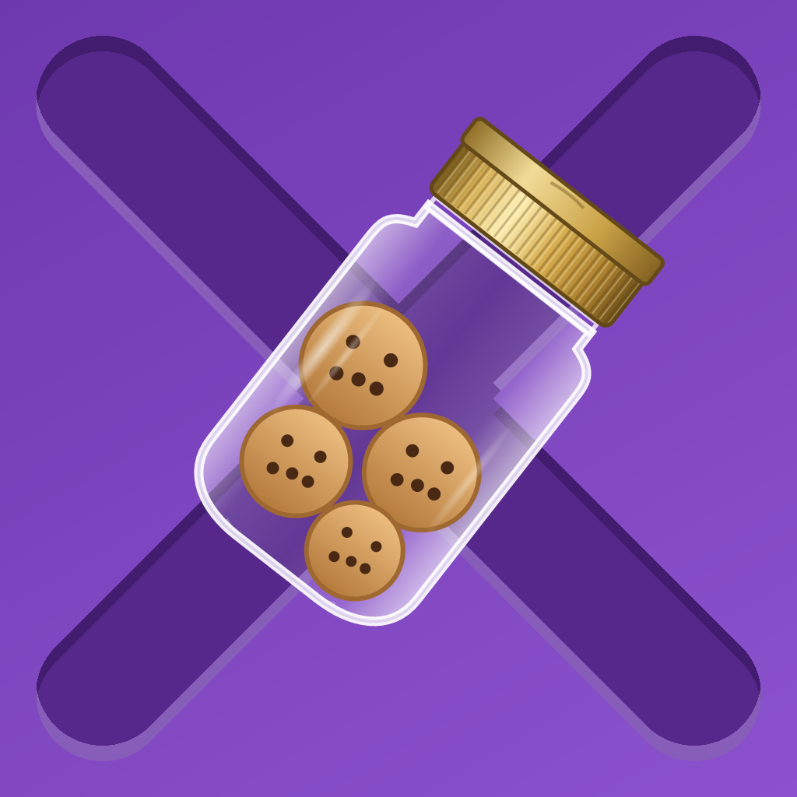

<p align="center">
  
</p>

<p align="center">
  <a href="https://www.gnu.org/licenses/agpl-3.0"></a>
</p>


# CookieJar — 基于 SwiftUI 的第三方 X 岛客户端

一个基于 SwiftUI 的第三方 X 岛客户端

## 安装

### AltStore

在 iPhone 上点击以下两个badge均可直接添加源。


<a href="https://altstore.io/source/raw.githubusercontent.com/kakenhidesu/CookieJar/main/altstore.json?app=com.kakenhi.cookieJar">
  <picture>
    <source media="(prefers-color-scheme: dark)" srcset="assets/DownloadBadge_dark.png">
    
  </picture>
</a>

或

<a href="https://celloserenity.github.io/altdirect/?url=https://raw.githubusercontent.com/kakenhidesu/CookieJar/main/altstore.json" target="_blank">
   
</a>

也可以手动添加源地址：

```
https://raw.githubusercontent.com/kakenhidesu/CookieJar/main/altstore.json
```

### TrollStore

到 [Releases](https://github.com/kakenhidesu/CookieJar/releases) 下载 `.ipa`，用 TrollStore 打开安装

### LiveContainer

CookieJar 需要 iOS / iPadOS 16.4 或更高版本。

1. 按照 [LiveContainer 官方安装指南](https://livecontainer.github.io/docs/installation) 安装并完成配置，包括 JIT-less 签名配置与诊断。
2. 到 [CookieJar Releases](https://github.com/kakenhidesu/CookieJar/releases) 下载最新版本的 `.ipa`，保存到「文件」App。
3. 打开 LiveContainer，点击右上角的「+」，选择下载的 CookieJar `.ipa` 文件并等待导入完成。
4. 在 LiveContainer 的应用列表中选择 CookieJar 启动。

## 启动

首次启动会请求：

* 相机权限（扫描饼干二维码）
* 相册权限（上传图片）

均可按需授权。

## 已知问题

* 官方搜索接口 `Api/search` 不可用，未实现相关功能，仅有串号跳转功能（看到了肥哥做的第三方搜索，我先放个todo在这
* 本地数据保存在 App Support 目录，卸载后会清除；饼干存储于 Keychain

## 致谢

感谢以下开源项目：

* [orzogc/xdnmb_api](https://github.com/orzogc/xdnmb_api)：提供 API 逻辑参考

## 一些废话

AppStore的上架和审核机制确实是一坨，看霞岛ios端也好久没更新了，先写一个自己用着
